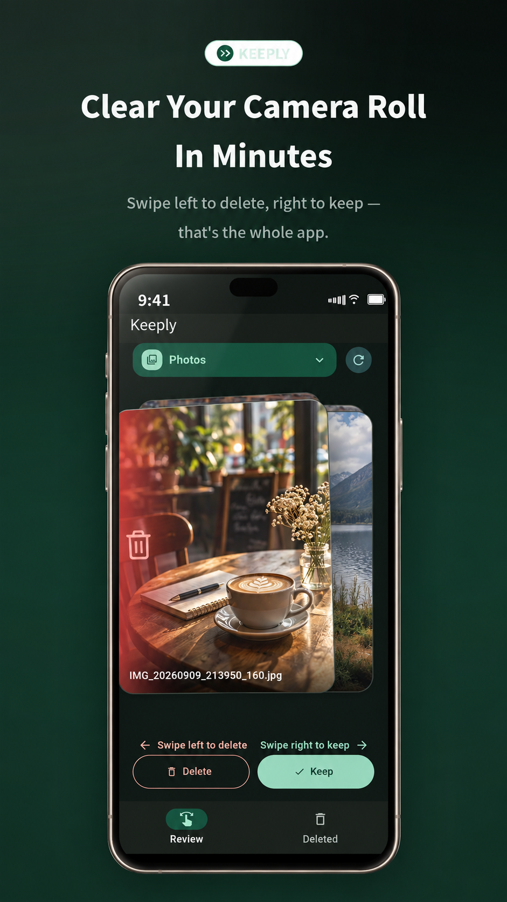
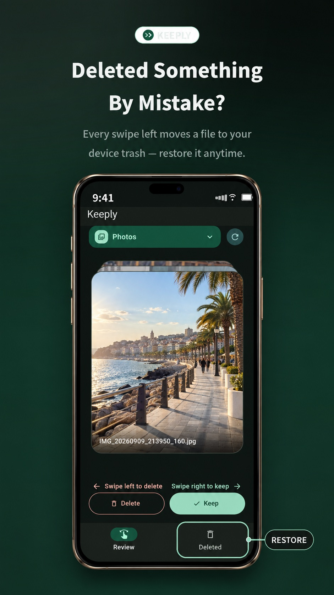
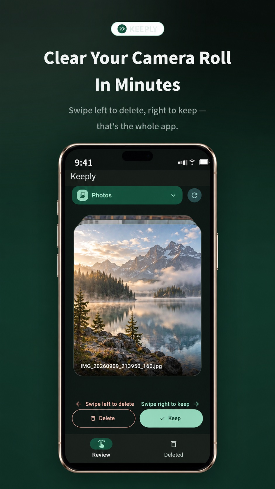
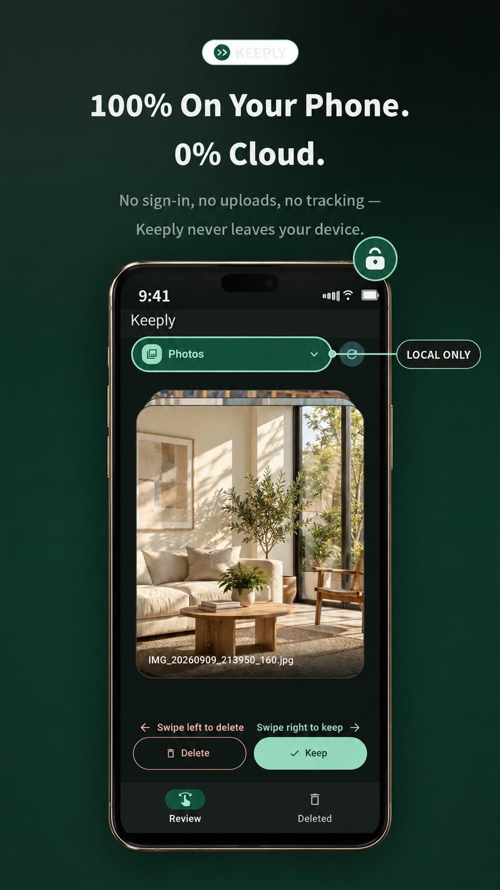

# Media Swipe 📸

**A simple, swipe-based way to clean up your phone's media library.**

Media Swipe is a minimal, local-first Android app built with Flutter that makes reviewing and cleaning photos and videos effortless.

Swipe left to delete. Swipe right to keep. No complicated file management, no unnecessary features — just a fast and intuitive way to organize your media.

## Screenshots

<p align="center">
  
  &nbsp;&nbsp;
  
</p>

<p align="center">
  
  &nbsp;&nbsp;
  
</p>

## Features

- **Swipe to Review:** Swipe left to delete and right to keep media.
- **Quick Actions:** Delete and Keep buttons for users who prefer tapping.
- **Photos & Videos:** Review both images and videos in one place.
- **Media Filtering:** Browse all media, photos, videos, and available device folders.
- **Deleted Media:** View deleted items in a three-column grid.
- **Restore Media:** Recover deleted items when supported by Android.
- **Interactive Tutorial:** Learn the gestures directly through the first card.
- **Newest First:** Review recently added media first.
- **Local-First:** No accounts, cloud storage, or unnecessary data processing.

## Tech Stack

| Technology | Purpose |
|---|---|
| Flutter | UI and application development |
| Dart | Primary programming language |
| Android MediaStore | Native media discovery and management |
| Kotlin / Android APIs | Native Android functionality |

## Architecture

The application follows a modular, feature-oriented architecture with clear separation between presentation, domain, and data layers.

```text
lib/
├── core/
│
└── features/
    ├── media_review/
    │   ├── data/
    │   ├── domain/
    │   └── presentation/
    │
    ├── deleted_media/
    │   ├── data/
    │   ├── domain/
    │   └── presentation/
    │
    └── sources/
        ├── data/
        ├── domain/
        └── presentation/
```

Android-specific media operations are abstracted behind repository interfaces, keeping the application logic independent of platform implementation details.

## Performance

Performance is a core part of Media Swipe.

- Uses Android MediaStore instead of repeatedly scanning the filesystem.
- Loads media metadata and thumbnails lazily.
- Uses pagination to handle large media libraries.
- Preloads upcoming media for smoother interactions.
- Avoids unnecessary full-resolution image and video decoding.
- Keeps the review interface responsive during media operations.

## Getting Started

### Prerequisites

- Flutter SDK
- Dart SDK
- Android Studio or Android SDK
- Android device or emulator

### Installation

1. Clone the repository:

```bash
git clone https://github.com/mjavadalj/media-swipe.git
```

2. Navigate to the project directory:

```bash
cd media-swipe
```

3. Install dependencies:

```bash
flutter pub get
```

4. Run the application:

```bash
flutter run
```

Grant the required media permissions when prompted.

## Platform

Currently developed for **Android**.

## Design Philosophy

Media Swipe is built around one simple principle:

> Open → Swipe → Swipe → Swipe → Done.

Every feature should contribute to making media cleanup faster and more intuitive. Simplicity and performance always take priority over unnecessary functionality.

---

<p align="center">
  Made with ❤️ and Flutter
</p>